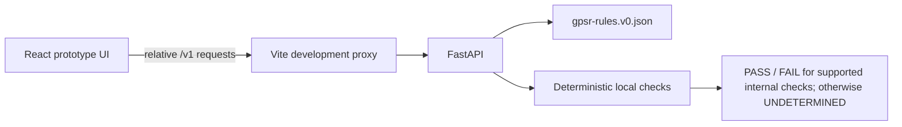

# Current architecture

> This file describes the implemented prototype. `SPEC.md` is a future-state plan; planned components are not live features.

## Implemented components

- **API (`backend/app/main.py`):** health, capability disclosure, rules metadata, and a single evidence-check endpoint.
- **Rule loader (`backend/app/gate/gate.py`):** loads rule data and requires explicit verification metadata. A quote match is reported as an exact-text integrity result only; it cannot establish that a legal assertion follows from the quote.
- **Local checks:** GTIN check-digit validation (`RF-ID-CHK`) and placeholder detection (`RF-PLACEHOLDER`). These are internal quality checks, not statutory compliance determinations.
- **UI (`frontend/`):** small form-based interface. The development server proxies relative `/v1` requests to the local API.

## Fail-closed behavior

- Missing or non-matching evidence returns `UNDETERMINED`.
- GPSR rules marked unverified return `UNDETERMINED`, even when their quote matches the submitted source.
- No legal compliance verdict is exposed by the API.
- `PASS` and `FAIL` are limited to the two implemented internal checks and must not be interpreted as product compliance outcomes.

## Not implemented

Listing ingestion, model calls, semantic recall matching, live legal-source checks, complete rule evaluation, telemetry orchestration, report/artifact generation, and sandbox verification remain future work. The repository does not currently perform any external model or web calls.
